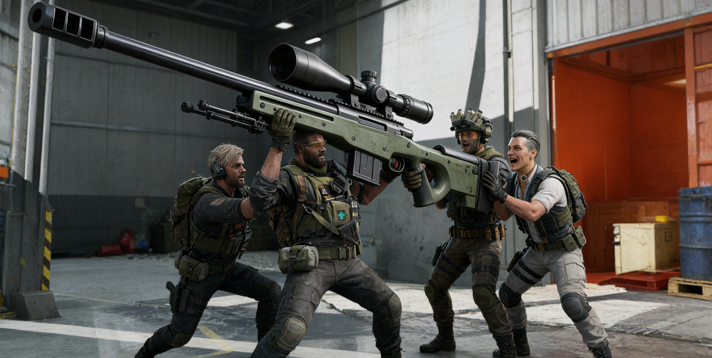

# Awesome Delta Force

> [!IMPORTANT]
> 
> ✨ 本项目长期维护，欢迎主播、UP主和普通玩家共同建设  
> ✨ 所有贡献者都会永久保留署名

> 注：目前仅开放收集功能，Leaderboard 正在建设中...

`Awesome_delta_force` is a lightweight open-source hub for **Delta Force gunsmith codes, meta rankings**, and optimized community builds. Quickly browse, copy, and apply loadouts to elevate your in-game performance.

本项目旨在收集**各平台主播及玩家改枪码**，持续更新中，欢迎大家补充。
- 
- 
- 
- 

## 如何为本项目贡献改枪码

欢迎社区一起维护和补充高质量的 Delta Force 改枪码！  
目前我们提供 **两种贡献方式**，请选择你最方便的一种。

### 📝 方式一：Pull Request（推荐）

如果你会使用 GitHub 或愿意用网页直接编辑，这是**最快、最直接**的方式。

**贡献步骤：**

1. Fork 本仓库
2. 打开 `data/`，选择对应的枪械种类文件（狙击枪/射手步枪/突击步枪）
3. 在文件末尾 **新增一行**，填写你的改枪码信息
4. 提交修改并发起 Pull Request

> 你可以直接使用 GitHub 网页编辑 CSV，无需本地环境。

**CSV 字段说明：**

| 字段名      | 含义                                |
| ----------- | ----------------------------------- |
| title       | 改枪方案标题（如：主播名 / 流派名） |
| weapon      | 枪械名称                            |
| price       | 改枪后价格（当前）                  |
| code        | 改枪码                              |
| description | 简要说明（适用场景 / 优点）         |
| contributor | 贡献者（GitHub / B站 / 昵称）       |

我们会在审核后合并到主分支，并在项目中展示。

### 📝 方式二：Issue 提交（不会 Git 也可以）

如果你不熟悉 GitHub 操作，**直接提交 Issue 即可**，我们会帮你整理进 CSV。

👉 点击右上角 **Issues → New Issue → Add gunsmith code**

请尽量填写完整信息，方便我们快速收录。